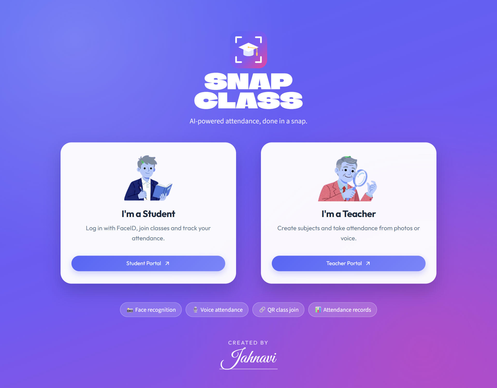
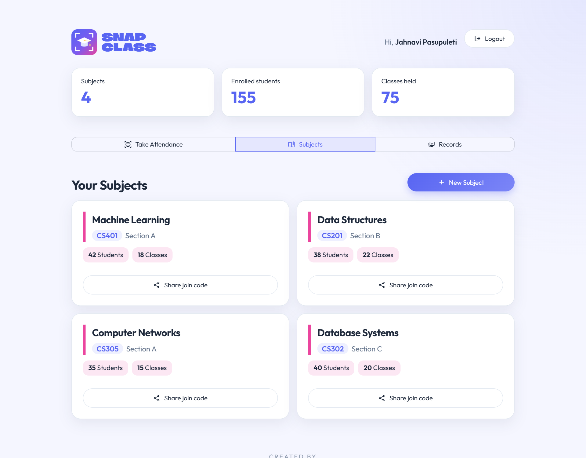
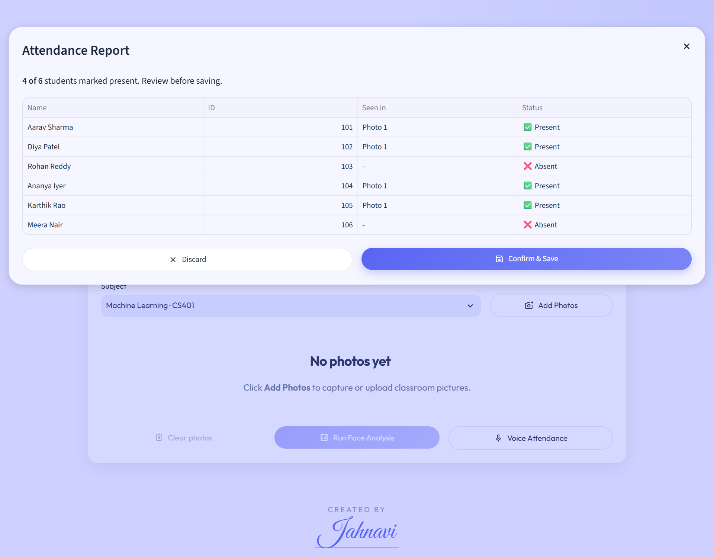
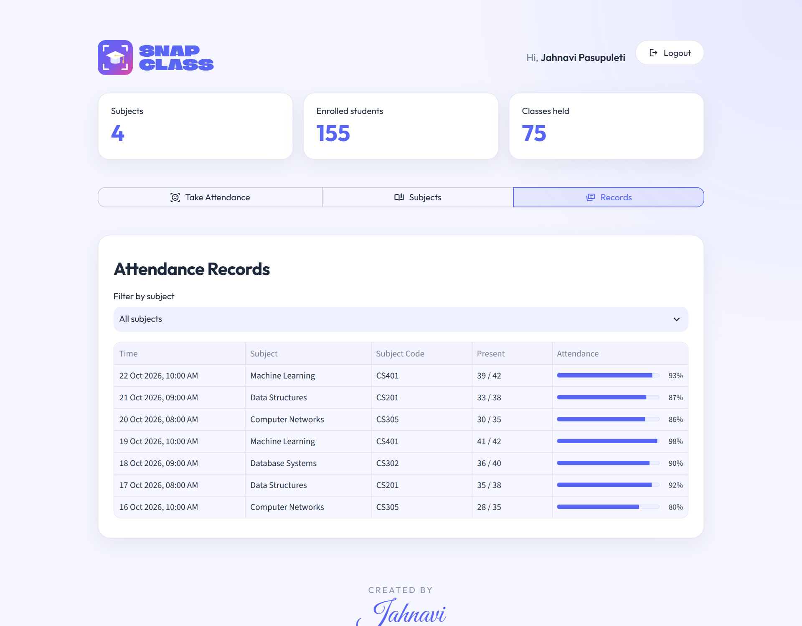
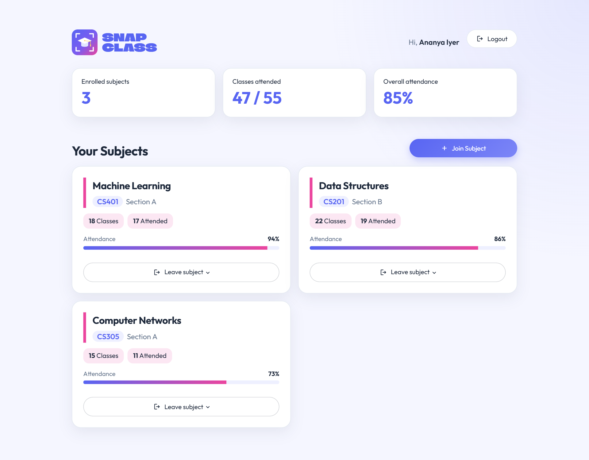
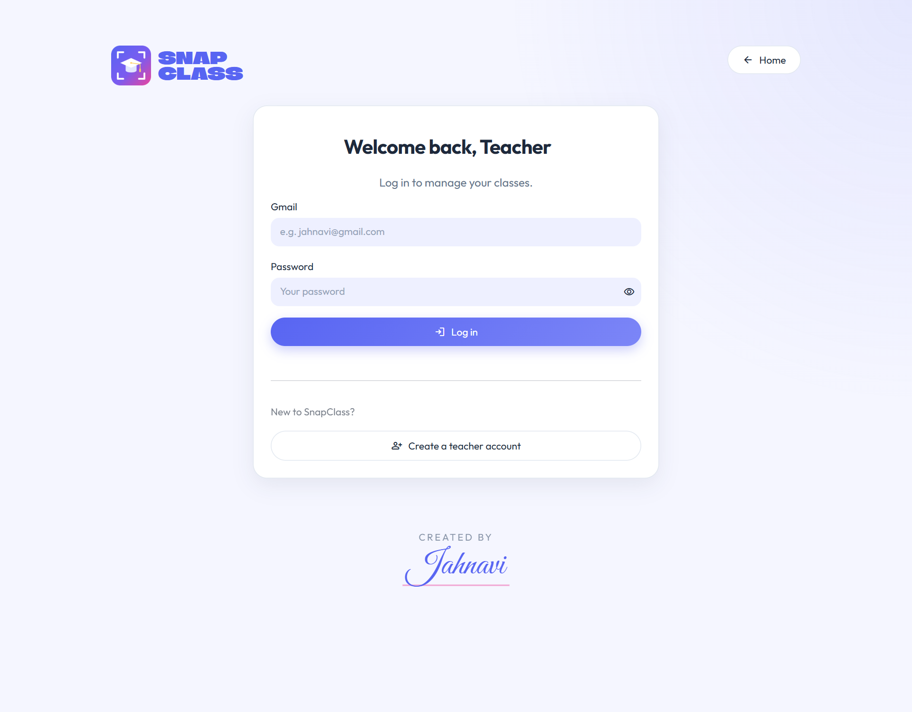

<div align="center">


# SnapClass

**AI-powered classroom attendance, done in a snap.**

Take attendance from a single classroom photo or a voice recording, and let students log in with their face.


<br/>

[](https://jahnavipasupuleti45-ai-classroom-app-hkshiq.streamlit.app/)

</div>

---

## Screenshots

<p align="center">
  
</p>

| Teacher dashboard | Attendance report |
|---|---|
|  |  |
| **Attendance records** | **Student dashboard** |
|  |  |
| **Teacher login** | |
|  | |

<sub>Screenshots use sample data.</sub>

---

## Features

**For teachers**
- 📸 **Photo attendance**: capture or upload one or more classroom photos, and SnapClass detects every face and marks enrolled students present or absent.
- 🎙️ **Voice attendance**: record students saying "I am present", and each voice is matched to a student's voice profile.
- ✅ **Review before saving**: every attendance run shows a report you confirm or discard.
- 📚 **Subject management**: create subjects with a code and section, and see student and class counts.
- 🔗 **QR class join**: share a join link and QR code so students can enroll with one scan.
- 📊 **Attendance records**: history of every class with attendance rate, filterable by subject.

**For students**
- 🙂 **FaceID login**: no passwords; log in by looking at the camera.
- 📝 **Quick sign-up**: register with a photo and an optional voice sample.
- ➕ **Join subjects**: by code, link or QR scan.
- 📈 **Personal dashboard**: classes attended and attendance % per subject.

---

## How it works

```
Classroom photo ─► dlib face detector ─► 128-d face embeddings ─► SVM classifier + distance check ─► Present / Absent
Classroom audio ─► split into speech segments ─► Resemblyzer voice embeddings ─► similarity match  ─► Present / Absent
                                                                    │
                                                         Supabase (Postgres) stores
                                              teachers · students · subjects · enrollments · attendance
```

- **Face recognition** (`src/pipelines/face_pipiline.py`): dlib's frontal face detector, 68-point shape predictor and ResNet face model produce a 128-dimension embedding per face. A linear SVM trained on all registered students predicts the identity, and a Euclidean distance threshold (0.6) rejects unknown faces. Student login uses nearest-match with an ambiguity margin so two similar faces are never confused.
- **Voice recognition** (`src/pipelines/voice_pipeline.py`): audio is split on silence with librosa, each segment is embedded with Resemblyzer, and matched to enrolled students by cosine similarity (threshold 0.65).
- **Data** (`src/database/`): Supabase Postgres accessed through `supabase-py`; teacher passwords are hashed with bcrypt.

---

## Tech stack

| Layer | Tools |
|---|---|
| UI | Streamlit, custom CSS |
| Face AI | dlib, face_recognition_models, scikit-learn (SVM), NumPy |
| Voice AI | Resemblyzer, librosa |
| Database | Supabase (PostgreSQL) |
| Other | bcrypt (password hashing), segno (QR codes), Pillow, pandas |

---

## Getting started

### 1. Prerequisites
- Python **3.12**
- A free [Supabase](https://supabase.com) project
- A webcam (and microphone for voice features)

### 2. Install

```bash
git clone https://github.com/JahnaviPasupuleti45/ai-classroom.git
cd ai-classroom
python -m venv .venv

# Windows
.venv\Scripts\activate
# macOS / Linux
source .venv/bin/activate

pip install -r requirements.txt
```

### 3. Set up the database
1. Open your Supabase project → **SQL Editor**.
2. Paste and run the contents of [`supabase_schema.sql`](supabase_schema.sql). This creates the 5 tables and their access policies.

### 4. Add your keys
Create `.streamlit/secrets.toml` (it is git-ignored):

```toml
SUPABASE_URL = "https://<your-project-ref>.supabase.co"
SUPABASE_KEY = "<your-publishable-key>"
```

Find both under **Project Settings → API** in Supabase.

### 5. Run

```bash
streamlit run app.py
```

Open http://localhost:8501, or try the hosted version at **https://jahnavipasupuleti45-ai-classroom-app-hkshiq.streamlit.app/**.

---

## Usage

1. **Teacher**: Teacher Portal → create an account with your Gmail → **Subjects** → **New Subject**.
2. **Share**: click **Share join code** on the subject card to get a link and QR code.
3. **Student**: Student Portal → take a photo → not recognized? Enter your name (and optionally record your voice) → **Create Account**.
4. **Join**: the student scans the QR code or clicks **Join Subject** and enters the code.
5. **Attendance**: teacher → **Take Attendance** → pick the subject → **Add Photos** → **Run Face Analysis** (or **Voice Attendance**) → review → **Confirm & Save**.
6. **Records**: see every class and its attendance rate in the **Records** tab.

---

## Project structure

```
snap-class/
├── app.py                      # Entry point and routing (home / teacher / student, QR join)
├── supabase_schema.sql         # Database tables and policies
├── requirements.txt
├── .streamlit/
│   ├── config.toml             # Theme
│   └── secrets.toml            # Your Supabase keys (not committed)
├── ui/
│   └── base_layout.py          # Global styles
└── src/
    ├── screens/                # Home, teacher and student screens
    ├── components/             # Header, top bar, footer, subject card, dialogs
    ├── pipelines/              # Face and voice recognition
    └── database/               # Supabase client and queries
```

---

## Security notes

This is a learning project. Before using it with real students:
- The default policies in `supabase_schema.sql` allow full access to anyone with the publishable key. Tighten Row Level Security, or move database access behind a server-side key.
- Face login has no liveness check, so a printed photo could be used to log in.
- Face and voice embeddings are biometric data; get consent and follow your local privacy rules.

---

## Roadmap

- [ ] Liveness detection for FaceID login
- [ ] Stricter Supabase security policies
- [ ] Attendance trends chart and low-attendance alerts
- [ ] CSV export of attendance records
- [x] Public deployment on Streamlit Community Cloud

---

<div align="center">

Made with 💜 by **Jahnavi Pasupuleti**

</div>
